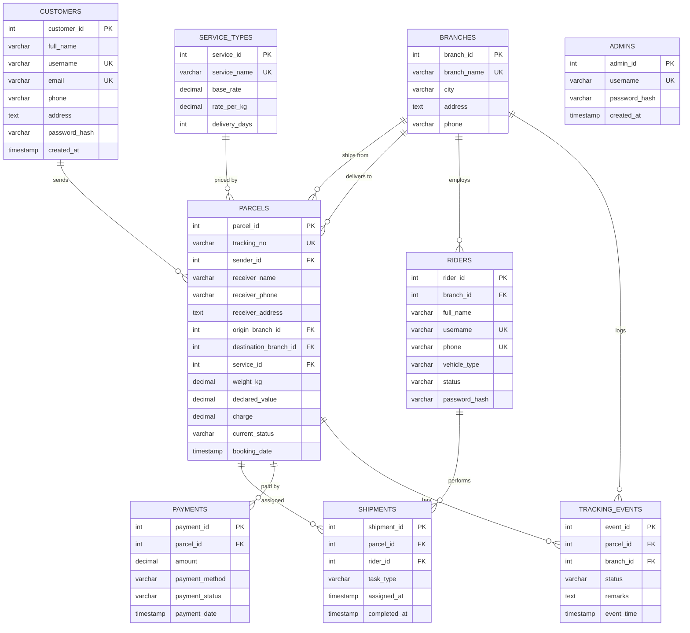

# ParcelTrack

Courier and Parcel Tracking System — Database System Laboratory (ECE 3210), KUET, Group B8.

A web application for a multi-branch courier company. Every button on the site runs a real
SQL statement (search, insert, update, delete) on a PostgreSQL database. The interface is kept
simple because the focus of the project is database design and queries.

**Stack:** PostgreSQL · Python Flask · psycopg2 (raw SQL, no ORM) · HTML, CSS, JavaScript, Bootstrap

The work plan is in [MILESTONES.md](MILESTONES.md).

## Features

| Feature | User | Database operation |
|---|---|---|
| Register / update profile | Customer, Admin | INSERT, UPDATE |
| Track a parcel by tracking number | Anyone | SELECT with JOIN |
| Book a parcel, charge calculated from weight and service | Customer, Admin | INSERT ... SELECT |
| Cancel a booked parcel | Customer | DELETE (cascades to child rows) |
| Add, edit, remove, search customers, riders, branches, services | Admin | INSERT, UPDATE, DELETE, SELECT |
| Assign a pickup or delivery rider | Admin | INSERT, UPDATE |
| Update parcel status | Admin, Rider | INSERT + trigger UPDATE |
| Record payments, collect cash on delivery | Admin, Rider | INSERT, UPDATE |
| Revenue and rider-wise delivery reports | Admin | SUM, COUNT, GROUP BY |
| Branch-wise parcel count, delayed deliveries | Admin | Views, subqueries |

## Database

Nine tables. Files are in [`database/`](database):

- `schema.sql` — tables, constraints, indexes, trigger and views
- `seed.sql` — sample data (50 branches, 25 riders, 36 customers, 77 parcels with their history)
- `queries.sql` — the main queries of the project, runnable on their own



Design points:

- **Charge** = `base_rate + rate_per_kg × weight_kg`, calculated inside the `INSERT ... SELECT` that books the parcel.
- **Tracking number** such as `PT26111000078` is generated by a column default from the booking date and a sequence.
- **Status log:** every status change is a row in `tracking_events`; the trigger `trg_sync_parcel_status`
  copies the newest status to `parcels.current_status`.
- **Status order:** booked → picked up → in transit → at hub → out for delivery → delivered / returned.
- **CHECK constraints** guard weight, amounts, status values, vehicle types and payment methods.
- **Transactions:** each request is one transaction, so booking (parcel + event + payment) or a status
  update (event + shipment + rider + payment) is saved completely or not at all.
- **Views:** `v_parcel_details`, `v_rider_deliveries`, `v_branch_parcel_count`, `v_delayed_deliveries`.

## Setup

1. Install Python 3 and PostgreSQL.
2. Install the packages:
   ```
   python -m venv .venv
   .venv\Scripts\activate
   pip install -r requirements.txt
   ```
3. Create the database and load the tables and sample data:
   ```
   createdb -U postgres parceltrack
   psql -U postgres -d parceltrack -f database/schema.sql
   psql -U postgres -d parceltrack -f database/seed.sql
   ```
   (In pgAdmin: create a database named `parceltrack`, open the Query Tool and run the two files in this order.)
4. Copy `.env.example` to `.env` and put your PostgreSQL password and a random secret key in it.
5. Start the site and open http://127.0.0.1:5000
   ```
   python app.py
   ```

## Sample logins

| Role | Login | Password |
|---|---|---|
| Admin | `admin` | `admin123` |
| Customer | `indrajit` (any customer's username) | `customer123` |
| Rider | `humayra` (any rider's username) | `rider123` |

A username is the person's first name in lowercase, skipping "Md." and initials like "H.M."; a repeated name gets a number
(`israt`, `israt2`). Admins can see and change usernames on the Customers and Riders pages.

## Project structure

```
app.py        Flask app: home, tracking, login, register, CSRF and error handling
db.py         database connection, one transaction per request
ops.py        shared parcel operations: book, assign rider, change status, delete
customer.py   customer pages
admin.py      admin pages, dashboard and reports
rider.py      rider pages
database/     schema.sql, seed.sql, queries.sql
templates/    HTML pages
static/       style sheet
tests/        end-to-end tests
```

## Tests

The tests rebuild a separate database from `schema.sql` and `seed.sql`, so the real data is not touched.

```
createdb -U postgres parceltrack_test
python -m unittest discover tests -v
```
